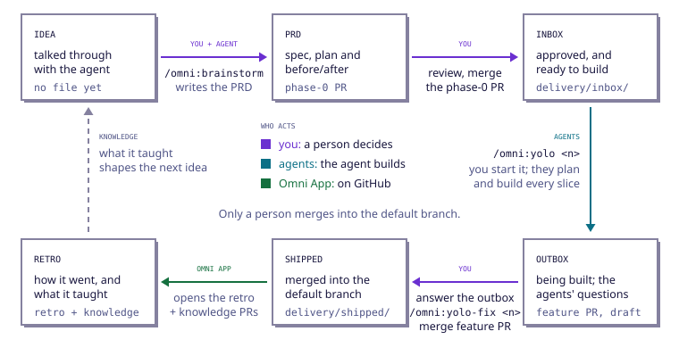
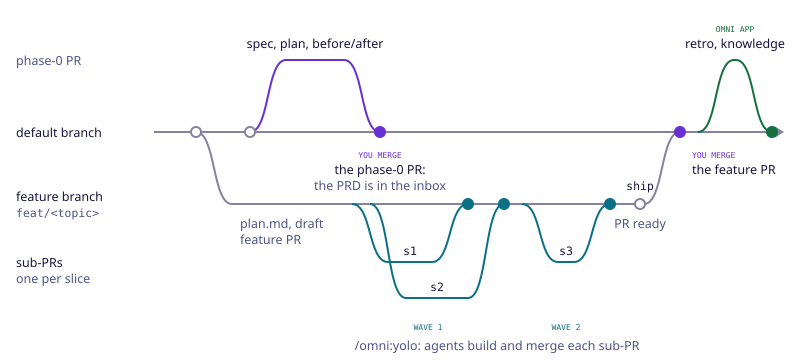

One PRD goes around one loop, from an idea to a retro. At three points it waits for a person;
everywhere else, agents do the work, and write down every decision they took without you. This page
shows the loop three ways: its stages, its pull requests, and its skills.
[Use cases](/docs/use-cases) then says what to type for each thing you want to do.

## The loop, stage by stage



| Stage | What it means | Where you see it | What moves it on |
|---|---|---|---|
| **idea** | talked through with your coding agent, nothing written yet | your coding agent's session | `/omni:brainstorm` writes the PRD; a vast idea goes through `/omni:think-big` first |
| **PRD** | a spec, a plan and a before/after page, waiting for a person's approval | the PRD issue, the phase-0 pull request, or the PRD's page when phase 0 is approved on the server | you merge the phase-0 pull request, or approve on the PRD's page |
| **inbox** | approved, ready to build | `.omni-loop/delivery/inbox/` | `/omni:yolo` builds it |
| **outbox** | being built; what the agents decided alone waits for you | the feature pull request, a draft | you answer the questions, then merge the feature pull request |
| **shipped** | the change is on the default branch | `.omni-loop/delivery/shipped/` | the Omni App opens the retro and knowledge pull requests |
| **retro** | how the delivery went, and what it taught | the retro and knowledge pull requests | you merge them, and the next idea starts from what they keep |

Three rules hold the loop together:

- **The folder is the status.** A PRD's folder sits in the inbox until it ships, and in the shipped
  folder after. `omni prd` followed by a PRD's number says where it is, and every skill looks there
  before it acts.
- **Only a person merges into the default branch.** The agents merge slices into a PRD's feature
  branch, never further. The phase-0, feature, retro and knowledge pull requests are yours to merge.
- **Every decision an agent takes alone becomes an outbox item,** which you answer or adopt. Nothing
  is decided behind your back, and nothing stops a build to wait for you.

### How long each step took

A PRD's page has a **Timeline** tab, after Plan. It lists the PRD's own milestones (idea, plan,
approved), then one lane per repository the PRD lands in (one lane for most PRDs), each with its
milestones and their dates, linked to their pull requests. Between two milestones it shows the step's
name, how long it took and who it waited on, and it marks the longest step. A step still going is
counted up to now; a milestone not reached yet reads `not yet`, and a step whose start was never
recorded reads `not recorded`, never zero. The line under the
stage words gives the total from idea to merged, or the time running so far, and the longest wait.

The Engineering board has a **Time per step** panel. For each step it gives the median over the PRDs
done in the board's period, how many PRDs it covers, and the slowest step.

## Your three gates

1. **The phase-0 pull request.** Merging it approves the PRD and puts it in the inbox, on the
   default branch (why, below). It holds documents only, no code: this is the cheapest moment to
   change your mind. In a repository whose phase 0 is approved on the server, there is no phase-0
   pull request: you approve the PRD on its page instead ([Approvals](/docs/approvals#phase-0-approved-on-the-server)).
2. **The outbox.** When the build is done, the feature pull request lists every question the agents
   met, in plain words, each with the option they built (always A) and the others. You answer them
   all in one comment, and `/omni:yolo-fix` rebuilds what you changed. The lighter decisions are
   adopted as each wave merges: they stand unless someone objects later.
3. **The feature pull request.** It is marked ready for review once no question is left open. Its
   description says what was built, how it was checked, the risk and how to roll it back. Merging it
   ships the PRD.

Between two gates, nothing asks you anything. Only two things hold a slice: a confirmed rule of your
knowledge base it would break, and an action only a person can take, such as adding a secret. Both
come back to you with what to do.

### Why the phase-0 pull request goes into the default branch

The PRD's feature branch already holds the spec, the plan and the before/after: `/omni:brainstorm`
wrote them there. The phase-0 pull request carries the same files, byte for byte, into the
**default branch**, and it is that merge which puts the PRD in the **inbox**. It matters for four
reasons:

- **The inbox is read on the default branch.** The folder is the status, and `omni status`, the
  status line and every teammate's checkout read the folders from the default branch. Until the
  phase-0 pull request is merged, they show the PRD as `in review`: counted apart, not yet
  approved. Once merged, its folder sits in `.omni-loop/delivery/inbox/` for everyone: approved,
  ready to build.
- **The merge is the approval, on record.** Only a person merges into the default branch. The merge
  says who approved which spec and which plan, and when, before a line of code was written.
- **The next PRDs can build on it.** Every new PRD starts from the default branch, so from then on
  it can read this spec and this plan, and name this PRD among the ones it waits for
  (`blocked-by`), which the kit accepts only for a PRD already in the inbox or shipped.
- **The feature pull request stays about the code.** Before it ships, `/omni:yolo` merges the
  default branch into the feature branch; the two copies of the documents are identical, so they
  reconcile to nothing. The feature pull request then shows what changed since the approval: the
  code, and the PRD's folder moving from `inbox/` to `shipped/`. You read the documents once, at
  phase 0, and the code once, at the end.

### Approvals

A PRD is approved once, before any code is written: through its phase-0 pull request, or with
**Approve** on its page. A PRD may also ask for a **Tech Approval** first, from one named member who
reviews the coding side with `/omni:tech-review`. [Approvals](/docs/approvals) has both: who approves,
what voids an approval, and the `omni/approved` check.

## The pull requests you will see



Every PRD opens the same few issues and pull requests, each with its label:

| Label | What it is | Opened by | Merged by |
|---|---|---|---|
| `omni:prd` | the PRD's issue: its number is the PRD's number | `/omni:brainstorm` | closed when the PRD ships |
| `omni:phase-0` | the PRD's folder alone: spec, plan, before/after; none when phase 0 is approved on the server | `/omni:brainstorm` | you, into the default branch |
| `omni:feature` | the whole change: a draft until no question is open | `/omni:plan`, run by `/omni:brainstorm` | you, into the default branch |
| `omni:sub` | one slice, or one rework | `/omni:wave`, `/omni:do-work` | the loop, into the feature branch |
| `omni:retro` | how the delivery went | the Omni App, once shipped | you |
| `omni:knowledge` | the decisions you settled, written back into the knowledge base | the Omni App, once shipped | you |

The retro and knowledge pull requests open only when the delivery taught something worth keeping.
When a retro keeps a lesson, the Omni App queues `/omni:retro-apply --retro <retro PR>` for a runner (the
same line is in the retro pull request's body, to run in your terminal): each lesson becomes a rule in a
playbook form, or stays here with its reason, and the retro pull request quotes each one for you to approve
before you merge it.
When a shipped PRD breaks main within seven days of its merge (a red job on its merge commit, a revert of
one of its pull requests, or a regression traced to it), the Omni App queues `/omni:rewind <n>` for a
runner, once: it walks back from the break to the spec and proposes, on the PRD's Main tab, where the
break started and what would have stopped it, for you to approve or reject.
When you approve a finding that started in knowledge nobody wrote down, about a playbook rule or a
product fact, the page queues `/omni:rewind-apply <n> <finding>` for a runner, sent by you: it proposes
the rule in one docs-only pull request in your repository (a playbook line, or a register entry marked
proposed, never a law), or names the rule that already says it, or asks you one question. The finding's
card shows which. It writes only in your repository's own knowledge, never the kit, and never merges.
Three more labels say a state rather than a kind:

- **`omni:in-progress`**: an agent is working on this pull request right now. Leave it be.
- **`omni:needs-fix`**: a slice or a check stayed red after its tries. Its status comment says what
  a person must do.
- **`omni:outbox-go`**: a person lets the outbox gate pass while questions are still open. The loop
  never adds it.
- **`omni:approved`**: on a PRD's issue, once a member approved it on its page (phase 0 on the
  server). For display: the loop reads the approval from the page, never from the label.

Each of the loop's pull requests carries a status comment, kept current: where it is, and the steps
left to a person.

## Laws and their tests

A few rules cost the most when they break. Your repository can **lock** them as laws, each proven by
a test, and only the people who own a law can approve a change to it. Every change to a rule, locked
or not, needs a person's answer on the pull request.
[Knowledge › Laws and their tests](/docs/knowledge#laws-and-their-tests) explains it all: locking a
law, owners and delegates, `/omni:enforce` and the sweep.

## Slices and waves

The PRD's plan, `plan.md`, cuts it into thin slices. Each slice has a **territory**, the files it
may touch; the slices it waits for; and a **wave**. The slices of a wave are built side by side,
each by its own agent in its own copy of the repository, each ending in its own sub-pull request.
The loop merges them into the feature branch one at a time, checks the wave as a whole, then starts
the next wave.

When a reviewer, a bot or a person, has left comments on a sub-pull request, the wave handles them
before it merges it, as `/omni:pr-care` handles the feature pull request's: each one is fixed,
pushed back with its reason, or left open for you. A comment left open for you holds that slice
alone, unmerged, and the wave says which; the rest of the wave goes on. Only the comments posted
when the wave reaches the slice count: it waits for no review still to come.

### A small plan builds without sub-pull-requests

A sub-pull request costs more than the work of its slice: a worktree of its own and an install, the
preflight before the pull request opens, its CI run, the claim, the status comment and the merge.
For a plan of one or two slices the feature pull request already is the record of the whole
feature, so a repository can ask for those to be built on the feature branch directly:

```yaml file=.omni-loop/config.yml
wave:
  inlineBelow: 3   # a plan with fewer slices than this builds inline; 0 (the default) never does
```

Below the threshold, `/omni:wave` builds each slice with `/omni:do-work --inline`, one after the
other, committed on the feature branch itself: no claim, no sub-pull request, no merge by an agent.
Everything else stays: the territory, the outbox questions and their accounts, the check of the
wave, and the feature pull request as the one pull request into the default branch, which ticks each
slice as `built inline` with its commit. A slice that stays red, or stops, pushes nothing to the
feature branch: its work waits on its slice branch, with no pull request, and the wave says so.
`omni board` reads a slice as merged once a commit on the feature branch carries its
`Omni-Slice: <id>` trailer line, and says `inline: true` in its `--json`. A PRD that already has a
sub-pull request finishes with them; a PRD of several landings counts the slices of the landing it
builds; a PRD that spans repositories never builds inline.

When `/loop /omni:drive` drives several PRDs, their waves also run side by side, up to three at
once and never two that touch the same files ([Drive the loop](/docs/drive#several-steps-at-once)).

In a repository that turned [design craft](/docs/design) on, a slice that changes a screen is also
looked at before its sub-pull request is marked ready: `/omni:do-work` runs `/omni:pixel-perfect
review` on its own, fixes what it can in one batch, and writes a **Design review** section on the
sub-pull request, one ✓, ✗ or — line per step. It never blocks: what it leaves becomes an outbox
question like any other.

A slice that stays red after its tries gets `omni:needs-fix`; it holds only the slices that wait for
it, and the rest go on. To see a PRD's slices, which are merged, in flight, stuck, ready or waiting,
and what can run next:

```bash terminal agent
omni board 7
```

## Which skill runs which


| Skill | Type it when | It ends with |
|---|---|---|
| `/omni:think-big` | you have a vast idea, one that would take several PRDs, and want to see bold directions before any is cut | the concept pull request, with its vision tour and its areas, and the concept's page under **Work › Concepts** on the Omni page; its last line is the `/omni:brainstorm --concept` line of the first area |
| `/omni:brainstorm` | you have an idea | the PRD issue, the phase-0 pull request (none when phase 0 is approved on the server) and the draft feature pull request; its last line is the `/omni:yolo` line |
| `/omni:yolo <n>` | the phase-0 pull request is merged, or the PRD is approved on its page | every slice merged into the feature branch; the feature pull request ready, or questions for you |
| `/omni:yolo-fix <n>` | you answered the questions | what you changed rebuilt, and the feature pull request ready |
| `/omni:roadmap <source>` | a milestone takes several PRDs, and you have its plan | every PRD's issue and spec, `roadmap.md`, and one phase-0 pull request; its last line is the `/loop /omni:drive --roadmap` line ([Roadmaps](/docs/roadmaps)) |
| `/loop /omni:drive` | PRDs, or with `--roadmap <n>` a roadmap, are approved and you want them built without typing each next command | each PRD ready, or parked with what it waits on; up to `limits.parallelSteps` steps (3 by default) run at once when they share no ground, and the loop stops itself ([Drive the loop](/docs/drive)) |
| `/omni:plan <n>` | a PRD has no plan yet; `/omni:yolo` runs it for you | `plan.md`, and the draft feature pull request |
| `/omni:wave <n>` | you want one wave at a time; `/omni:yolo` runs it for you | the wave's slices merged into the feature branch |
| `/omni:do-work <n> <slice>` | you want one slice alone; `/omni:wave` runs it for you | one sub-pull request into the feature branch |
| `/omni:pixel-perfect <command> <screen>` | you want a screen critiqued, audited or polished; with [design craft](/docs/design) on, `/omni:do-work` and `/omni:visual-fix` run its `review` for you | the screen fixed in one bounded pass, and a report |
| `/omni:pr` | a pull request of the loop is red or conflicts; the skills run it for you | the pull request green, or stuck, with the reason |
| `/omni:enforce <issue>` | a law issue (`omni:law`) waits for its test ([Laws and their tests](#laws-and-their-tests)) | one pull request a person merges: the law's test, seen red with the law broken and green with it restored |
| `/omni:retro-apply --retro <n>` | never by hand unless no runner took it: the retro pull request's body carries the line when a kept lesson has no outcome | each kept lesson settled on the retro pull request's branch: a rule appended to its playbook slot and quoted in the body, or the reason it stays here, or one question; it never merges |
| `/omni:rewind <n>` | never by hand unless no runner took it: a shipped PRD's page reads **Broke main**, and its Main tab carries the line until a rewind ran | the PRD's Main tab listing where the break started, each finding with its check, its evidence and its fix, for you to approve or reject; it writes nothing to the repository and never merges |
| `/omni:rewind-apply <n> <finding>` | never by hand unless no runner took it: an approved knowledge finding's card reads **Proposing the rule…** | one docs-only pull request proposing the rule in your repository's knowledge, or the rule that already says it, or one question, shown on the finding's card; it never merges |
| `/omni:tech-review <n>` | you were named for a PRD's Tech Approval ([Tech Approval](/docs/approvals#tech-approval)) | the coding parts of the spec and plan changed with you, each settled question recorded under `### Tech review`, and the PRD's page link; it gives no approval and never merges, and a runner never runs it |
| `/omni:invade` | once, after the install; with `--refresh` when the repository has changed a lot | one docs pull request: the knowledge base |
| `/omni:status` | you want to see where the PRDs are | one screen |
| `/omni:help` | you want to know what a command does | one screen |
| `/omni:ask on` | you would rather answer your agent's questions on a web page | the page's link |
| `/omni:dossier-open`, `/omni:dossier-push` | never: `/omni:brainstorm`, `/omni:think-big` and `/omni:plan` run them | the PRD's page on the Omni page, or a concept's page under **Work › Concepts** |

Every skill, what it does and when to use it: [Skills](/docs/skills). The table gives each skill in
the kit's form, `/omni:<name>`; an agent other than Claude Code types it in its own form
([Any coding agent](/docs/any-agent#set-up-your-agent)).

Given a name, `/omni:help` explains one skill or command: `/omni:help yolo`.

## In a terminal

A few `omni` commands are for you, in a terminal at the root of the repository or from your coding
agent (in Claude Code: with `!` before them). None of them changes anything, except `omni signin`, `omni update`, `omni knowledge judge`, which
writes the sweep's edits into your working tree and opens law issues, and the last two:
`omni roadmap answer` comments on the roadmap's issue, and `omni roadmap push` updates the roadmap's
page.

| Command | What it says |
|---|---|
| `omni status` | where the repository's PRDs are, read from git; with `--fetch`, fetched first |
| `omni status 7` | whether PRD 7 still has open questions: its outbox gate |
| `omni prd 7` | where PRD 7 lives, and its files |
| `omni board 7` | PRD 7's slices, and what can run next |
| `omni roadmap check 1200` | whether roadmap 1200 holds together: its PRDs wave by wave, or what it refuses |
| `omni kb show briefing` | one form of the playbook, as the agents read it: `briefing`, `testing`… |
| `omni knowledge BR-QUOTE-1` | one rule of the knowledge base, by its id |
| `omni knowledge judge [<id>]` | the sweep: asks "worth a law?" of every `unenforced` law, once per repository, or of the one law `<id>` names ([Laws and their tests](#laws-and-their-tests)) |
| `omni signin` | signs this laptop in to the Omni page |
| `omni version` | which kit the repository runs, and whether a newer one exists |
| `omni update` | opens the pull request that brings the repository to the newer kit |
| `omni help` | every command, on one screen |
| `omni roadmap answer 1200 Q5 "…"` | answers question Q5 of roadmap 1200, in a comment on its issue |
| `omni roadmap push 1200` | sends where each PRD of roadmap 1200 stands to its page; the drive runs it after every tick |

The skills run the others themselves, such as `omni ship` or `omni adopt`: you never need to.

[Next → Your first PRD](/docs/first-prd)
