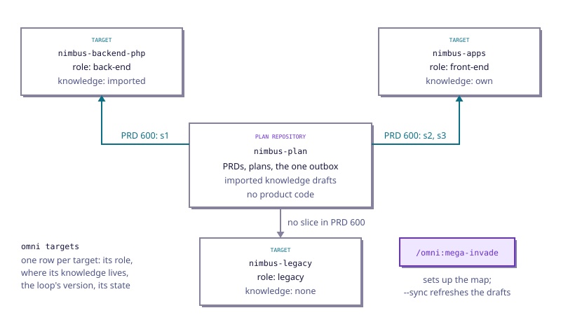

Some features land in more than one repository: the business logic in the back-end, the screen
that shows it in the front-end. The loop can plan and build such a feature from one place. This page
shows how, in three drawings: the repositories, the pull requests over time, and the skills. Learn
the loop on one repository first ([How the loop works](/docs/loop)); everything here builds on it.

## What it is

A **plan repository** holds the PRDs of such features, and no product code. Its **target
repositories** hold the code: each PRD's plan says, for every slice, the target it lands in. The
mode has one rule: **one plan, one phase-0, one gate**. You approve the whole feature once, in the
plan repository, and you answer every decision the agents took once, in the plan repository, while
the code's pull requests open in each target.

The example on this page is the same throughout: PRD 600 lives in `nimbus-plan`; its
slice s1 lands in `nimbus-backend-php`, and s2 and s3 in `nimbus-apps`.

There is a second way, with no plan repository at all: a **product PRD**, kept on a
[product](/docs/products) on the Omni page and run from any of its repositories.
[A product PRD](#a-product-prd) compares the two.

## The repositories



Each target has a **role**, one word such as `back-end`, `front-end` or `legacy`, and its knowledge
lives in one of three places: **own**, a knowledge base in the target itself, read where it lives;
**imported**, a draft of one written in the plan repository, under
`.omni-loop/knowledge/repos/<name>/`; or **none**.

### Set it up

Install the loop in the plan repository like any other repository
([Set up a repository](/docs/install#set-up-a-repository)), then, at its root, type (in your
agent's form: [Any coding agent](/docs/any-agent#set-up-your-agent)):

```text agent
/omni:mega-invade
```

It reads the page of your plan repository that says which repository does what (a guide with one
`## <name>` heading per repository), and the targets its config already lists. It reads each of
them through GitHub, without cloning it, and shows you **one map**: whether each has the loop, its
version, and whether it has a knowledge base of its own. Then it asks, in one list, for each one:

- **target or not**, and its **role**;
- for a target without a knowledge base of its own, **import one or not**. Import reads a shallow
  copy of that repository, never runs anything in it, and writes the draft in your plan repository.
  A target that has its own is read where it lives, never copied.

One thing is copied for **every** target, `own` and `none` included: its **planning config**, the
keys of its own `.omni-loop/config.yml` that shape a plan (`flow`, `landings.alone`, `pr.openWith`
and `contracts`, [Repository flow](/docs/flow)), with the hook files its flow names, under
`.omni-loop/knowledge/repos/<name>/flow/`. Nothing a person wrote is copied, only config. That copy
is how `omni plan check` grades a slice landing in a target by the target's own rules: its flow
areas, its paths that land alone, and whether it asks each slice to declare its contract
([Contracts](/docs/flow#contracts)). So once the copy of an `own` target exists, its flow areas and
its `landings.alone` reach the plan repository's `plan check` too, and a plan that breaks them goes
red there.

It writes only in your plan repository, never in a target. It ends with one docs-only pull request:
the imported drafts, the `plan` section of `.omni-loop/config.yml` in a commit of its own, a table of
where each target stands, and, for each gap, the step to take in that repository:
`npx omni-loop init`, then `/omni:invade` there. You merge it.

From then on, to see where each target stands:

```bash terminal agent
omni targets
```

It prints one row per target: its role, where its knowledge lives, the loop's version, and its
state: `ok`; `stale` when an imported draft was read before a change to a file it was drawn from,
when a target's planning config moved since its copy (`flow moved since read at <commit>`), or when
a target, `own` included, commits a planning config that has no copy yet (`flow not copied`);
`drifted` when the config no longer says what the repository has; `unreachable` when GitHub will not
show it to you. It reads and never changes anything. To refresh the stale drafts, type:

```text agent
/omni:mega-invade --sync
```

It redraws only what changed, every stale planning config included, never rewrites what a person
wrote, proposes to drop the draft of a
target that now has its own knowledge base, and opens one pull request, or none when there is
nothing to do.

### Read-only and consumer targets

The targets are listed under `plan.targets` in `.omni-loop/config.yml`. Two optional keys on a
target say what may change in it, and in what order:

```yaml file=.omni-loop/config.yml
plan:
  targets:
    - repo: demo-org/nimbus-backend-php
      role: back-end
      knowledge: imported
      readAt: 3f9c2a7e1b0d4c8a9e6f5d2b1a0c9e8d7f6a5b4c
    - repo: demo-org/nimbus-apps
      role: front-end
      knowledge: own
      consumes: [nimbus-backend-php]
    - repo: demo-org/nimbus-legacy
      role: legacy
      knowledge: none
      readOnly: true
```

- **`readOnly: true`**: the loop still reads the target, surveys it and can import its knowledge, but
  nothing may land in it.
- **`consumes`**: the short names of the other targets whose packages this one installs, from their
  default branch. A change in such a provider reaches the consumer only once it has merged there, so
  it cannot be built in the same PRD as the code that uses it: it must be an earlier PRD. Only the
  targets the list names count; a chain through a third target is not followed.

Two checks hold them:

- **`omni plan check`** refuses a plan with a slice in a `readOnly` target, and a slice in a consumer
  target blocked by a slice in a target it consumes. Move the provider's change into an earlier PRD,
  and block this one on it.
- **`omni roadmap check`** applies them to a roadmap's rows: no row may name a `readOnly` target, and
  a PRD in a consumer target sits in a later wave than every PRD it waits on, directly or through
  others, that changes a target it consumes. The rule follows the blockers: two PRDs that do not wait
  on each other may share a wave. [What the check refuses](/docs/roadmaps#what-the-check-refuses).

### Name a product instead

When a [product](/docs/products) on the Omni page holds these repositories, the plan repository can
name it in place of its list: each link of the product is a target, with its role, knowledge, read
at, read-only and consumes. First copy the list into the product, once, from the plan repository:

```bash terminal agent
omni product import --product Mobile
```

Each target becomes a link of the product, a link that exists is changed to match, and it prints
what it added and changed; run again, it changes nothing. It stops at the first link the Omni page
refuses, naming why: fix it and run it again. It never edits your config: swap `targets` for
`product` yourself.

```yaml file=.omni-loop/config.yml
plan:
  guide: docs/repositories.md
  product: Mobile
```

A config names `product` or `targets`, never both: with both it is refused, naming the two keys.
`omni targets` then reads the product's links from the Omni page, signed in as you (`omni signin`),
and prints the same table. A link with no role is refused by name:
`demo-org/nimbus-backend-php has no role in product Mobile: set it on the product page`. Each read
is kept in `.omni-loop/local/product-targets.json`: when the Omni page does not answer within five
seconds, `omni targets` reads that copy and says `targets from the last read, <date> · server
unreachable`; with no copy yet, it stops with `no targets: the server is unreachable and nothing was
read yet`. When the page refuses you, it stops with its reason.

`omni board`, `omni next`, `omni care` and `omni flow` read the same targets, so the skills that
plan, build and look after a PRD work with a product named. When the Omni page cannot be read, each
uses the last read, with a note, or stops with one line saying why. A few readers still see only
`plan.targets`, which is empty when the config names a product: the status line's board, roadmaps,
bug fixes across repositories, `/omni:mega-invade --sync` and the retro. Keep `plan.targets` while
you need those. A config that keeps `plan.targets` reads its targets from there.

## Plan across them

Once the targets are set, plan a feature across them. In the plan repository, type:

```text agent
/omni:mega-brainstorm
```

It is `/omni:brainstorm` for several repositories: it talks the idea through with you, asks which
repository does what (it never assumes it), and reads each one it touches from a copy that nothing
runs in. It writes one PRD whose plan has a `repo` column: the repository of every slice. The spec,
the plan, the draft feature pull request and **one phase-0 pull request** all open in the plan
repository; nothing is written in a target, and no target gets a phase-0 pull request.

The phase-0 pull request adds a **What lands where** table, so each team finds its part: one row per
repository, with its role, its slices and the waves they sit in. Every team reads the whole feature
side by side before any code exists. A person reviews it and merges it, which puts the PRD in the
plan repository's inbox.

### Names follow each repository's conventions

Before it names a table, a column, a GraphQL field or a service in a target, the brainstorm reads
where that target writes its conventions down. `omni conventions --root <clone>` lists those files
from the target's read-only copy, and the agent reads the pages the design bears on: the pages on
the database and its migrations for a new table or column, the pages on the schema for a GraphQL
change. `/omni:plan` does the same for each target a slice may land in.

The index holds, in this order:

1. `CLAUDE.md` and `AGENTS.md` at the root, and every file they import with `@<path>`.
2. The files the target's `.omni-loop/config.yml` lists under `paths.context`, when it has one.
3. The readme of the `docs` folder (`README.md`, `readme.md` or `index.md`).
4. The readme of `docs/adr`, or, without one, every ADR in it.
5. Every Markdown page those files link to, one level of links only, inside the repository. A link
   to a file that does not exist reads `missing`.

So a page is read only when one of those files links to it. A `docs/migrations.md` that nothing
links to is never found: link it from the target's `CLAUDE.md` or from the readme of its `docs`
folder. A target needs no omni config for this.

The spec then carries a `## Conventions` table, one row per name the design picks, each with the
page and line it comes from (`_created_at ← docs/migrations.md:12`), or the neighbouring code it
copies when no page settles it. When two conventions coexist and no page says which one wins, the
agent asks you during the design; it never picks one silently. Read that table when you review the
phase-0 pull request: a name without a source is the one to question.

## The pull requests over time


Time runs left to right, as in the [single-repository drawing](/docs/loop#the-pull-requests-you-will-see).
The plan repository gets two pull requests: the one phase-0, and the **plan pull request**, its
feature pull request, which holds the one outbox and closes the PRD. Each target gets one **target
pull request**, built slice by slice through sub-pull requests the agents merge into it, wave by
wave. Every decision an agent takes alone in a target comes back to the plan repository's outbox.
The numbers are the order you merge in: each target pull request first, the plan pull request last.

## Build

Once the phase-0 pull request is merged, build the feature. In the plan repository, type:

```text agent
/omni:ultra-yolo 600
```

with your PRD's number. It is `/omni:yolo` for several repositories:

- it opens **one feature pull request in each target**, and builds every slice there as a sub-pull
  request into it, wave by wave;
- it **relays every decision** the agents took in a target into the one outbox of the plan
  repository, where you answer them all in one place;
- in a target it runs **nothing but that repository's own committed checks**, the ones its config
  names: its `setup` (as `pnpm install --frozen-lockfile`), when its team committed one, then its
  `preflight`, both in the same fresh worktree. A target with no `setup` runs its preflight alone;
  one with no preflight runs nothing, and its pull request's CI is the check. A setup that fails
  holds that target as stuck, quoting its failing line: the agent never edits the target to make it
  pass, since a broken install belongs to the target's team;
- it marks each target pull request ready once its CI is green, and the **plan pull request ready
  last**, after all of them;
- it tells you the **order to merge in**: each target's pull request first, in the order of their
  earliest wave, then the plan repository's, which closes the PRD.

It never merges into any repository's default branch. You do.

### A target's smoke, for a bug only the build shows

`/omni:mega-bug-fix` runs the same two commands in a target, then one more when it needs it. A target
that wants bug fixes proven against what it ships commits `commands.smoke` in its
`.omni-loop/config.yml`, beside `setup` and `preflight`:

```yaml file=.omni-loop/config.yml
commands:
  setup: bun install --frozen-lockfile
  preflight: bun run lint && bun run test
  smoke: bun run build && bun run test:smoke
```

`smoke` **builds what the repository ships to production, then checks the built output**: for a
front-end it serves the production bundle and loads each route; for a server-rendered app it renders
each route from the built server. The bug-fix skills run it only when a passing reproduction cannot
see the bug (an error that only the production bundle produces, or a regression range that changes the
bundler or the framework): the reproduction is added as one more case of `smoke`, which must fail
before any fix and pass after it. They read it from the target's default branch, run it after its
`setup`, and never edit the target's CI. A target with no `smoke` it can run makes the skill stop, keep
the reproduction on a pushed branch, and comment the line to commit. Run `smoke` in CI too: it is then
the guard that keeps the bug from coming back.

A PRD whose spec was merged without a plan, as a roadmap leaves them, is planned first: the plan says
which slice lands in which target, and `omni plan check` grades it before the first wave.

## Hold a consumer until its provider is served

One of the pull requests of a feature may need another's to be merged first: a **provider** adds a
field, an endpoint or a column, and a **consumer** reads it. A consumer's pull request body says so
with one line per provider, `Merge after <owner/repo>#<n>`. `/omni:ultra-yolo` and `/omni:ultra-wave`
write those lines for each provider target the plan makes a consumer wait for, as `/omni:mega-bug-fix`
does for a fix. A pull request with no such line is never held.

To read where one stands, type:

```bash terminal agent
omni hold demo-org/web#88
```

With `demo-org/web#88` saying `Merge after demo-org/api#41`, it prints one row per provider and a last
line:

```text terminal
demo-org/api#41   open                       held
held: demo-org/api#41 open
```

An open provider is `held`; a merged one is `clear`, unless the provider's repository says how to tell
that it is served, in which case the row is `probe` and names the hook; a provider closed without
merging is `fail`; one GitHub cannot be asked about is `not judged`, and is never counted as clear.
It reads and runs nothing of the provider. The skills that would mark the consumer ready run it first,
follow each probe it names, and leave the pull request a draft unless every row is clear or passes,
with `waiting for demo-org/api#41 to be served: <why>` on the status comment. A provider closed
without merging raises one high outbox item naming both pull requests.

The provider declares its probe once, in its own config, at the point
[`merge-after.served`](/docs/flow#the-points); a probe that answers `wait` is asked again. `/loop /omni:mega-drive`
and `/omni:drive` park a held PRD on that line, run `omni hold` again each tick and mark the pull
request ready once it is clear. A probe still waiting after `limits.stallDays` is reported stuck on the
status comment, naming the provider and the last reason. Nothing else notifies anyone, and merging stays yours.

## Drive it

To leave several multi-repository PRDs building without typing each next command, drive them from
the plan repository:

```text agent
/loop /omni:mega-drive
```

It is [driving the loop](/docs/drive#drive-a-plan-repository) with the skills that build across
repositories; `--roadmap <n>` drives a roadmap's PRDs.

## Which skill runs which


| Skill | Type it when | It ends with |
|---|---|---|
| `/omni:mega-invade` | once, in the plan repository; with `--sync` when an imported draft went stale | one docs pull request: the map and the imported drafts |
| `/omni:mega-brainstorm` | you have an idea that spans several repositories | the PRD issue, the draft plan pull request and one phase-0 pull request; its last line is the `/omni:ultra-yolo` line |
| `/omni:ultra-yolo <n>` | the phase-0 pull request is merged | a target pull request per target, ready; the plan pull request ready, or questions for you |
| `/omni:ultra-yolo-fix <n>` | you answered the questions on the plan pull request | each rework built in its own target, and the plan pull request ready |
| `/omni:ultra-wave <n>` | you want one wave at a time; `/omni:ultra-yolo` runs it for you | the wave's slices merged into their targets' feature branches |
| `/omni:mega-pr-care <n>` | the pull requests are open, after `/omni:ultra-yolo` or alongside it; leave it running | every pull request of the PRD, the plan's, each target's and each linked bug fix's, kept conflict-free, green and review-handled round by round, until each is merged or closed; it never merges |
| `/omni:mega-roadmap <source>` | a milestone takes several multi-repository PRDs, and you have its plan | every PRD's issue and spec, each saying where it lands, `roadmap.md`, and one phase-0 pull request; its last line is the `/loop /omni:mega-drive --roadmap` line |
| `/loop /omni:mega-drive` | several PRDs are merged into the inbox, or a roadmap with `--roadmap <n>`, and you want them built without typing each next command | each PRD ready, or parked on its plan pull request with what it waits on; the loop stops itself |
| `/omni:mega-bug-fix` | a bug shows in one target and its cause may sit in another; `--prd <n>` links it to a PRD | one bug issue with a fix plan, one fix pull request per target in merge order, provider first, and a record pull request that closes the issue, merged last |

`/omni:do-work` and `/omni:pr` are the same skills the single-repository loop runs: `--target`
builds a slice in its target repository, and `--repo` opens and follows its pull request there. You
never type either flag.

## A red gate

When the agents met questions, the plan pull request stays a draft, with the questions posted on it.
Answer them there, in one comment, as you would on one repository, then, in the plan repository,
type:

```text agent
/omni:ultra-yolo-fix 600
```

It reads your answers on the plan pull request and reworks each decision you changed **in the
repository it was taken in**: a sub-pull request into that target's feature branch. Then it runs the
same gate again, and marks the plan pull request ready once no question is left.

## The plan repository stays

A plan repository is **kept**. The loop never archives it, nor deletes it, whatever step its
repositories have reached on the [rollout ladder](/docs/products#the-rollout-ladder). Its PRDs, its
roadmaps, its bug records and its imported knowledge copies keep working as they do here, side by
side with the product way: a repository below step 5 stays on the old way, and a roadmap or bug
record born in git finishes in git.

A [product](/docs/products)'s **Repositories & approvers** tab shows, as information only, each
repository's ladder step and what still lives in its plan repository, such as `nimbus-web · step 3`
or `roadmap 0412 · in git`. It has no action on the plan repository.

The skills and checks read an imported target's knowledge from its pack, which the server keeps,
rather than from a copy under `.omni-loop/knowledge/repos/`; `omni kb pack get <repo>` fetches it.
The [knowledge packs](/docs/products#knowledge-packs) section says how a pack is fetched and refused.

### Business laws

A product's [business laws](/docs/knowledge#business-laws) live in the plan repository, which is the
product's law home: set `products.plan_repository`, and put the PM in `laws.owners`. Without a plan
repository, a product with several repositories has no law home and nothing is judged. A target's
imported copy of its laws under `repos/<target>/` never counts. A target repository with a phase-0
pull request must require the `business laws` check for a red to stop its merge.

## A product PRD

A feature that lands in several of a [product](/docs/products)'s repositories can live on the
product itself. Such a **product PRD** (◆) has no home repository, no GitHub issue and no folder in
any repository. Its id is the product's key and a counter, such as `mobile-12`. Its spec, plan,
before/after page and voice are versions on its page on the Omni page, and so are the questions its
agents raise. You run the same skills from a checkout of any of the product's repositories that has
the loop installed.

Its code still lands on GitHub: one feature pull request per repository, each saying
`Part of mobile-12`. There is **no plan repository, no phase-0 pull request and no plan pull
request**. You approve it once, on its page, and you answer its questions once, on the product's
**Questions** tab.

| step | in a plan repository | as a product PRD |
|---|---|---|
| brainstorm | `/omni:mega-brainstorm`: an issue, a draft plan pull request and one phase-0 pull request | `/omni:mega-brainstorm --product mobile`: the PRD on its page, and nothing in any repository |
| approve | merge the phase-0 pull request | approve it on its page |
| build | `/omni:ultra-yolo 600` | `/omni:ultra-yolo mobile-12` |
| each target's feature pull request | the outbox check points at the plan pull request | two checks: `omni/approved`, and the outbox check, read from the Omni page |
| questions | answered on the plan pull request | answered on the product's **Questions** tab, or in the terminal |
| the gate | `omni status 600`, then the plan pull request ready last | `omni status mobile-12`, then each target's pull request ready; there is no plan pull request |

### Before you start

- **The product has a key.** One short lowercase word, such as `mobile` or `field-app`, that starts
  every one of its PRD ids. An owner of the workspace sets it once, and nobody changes it after. The
  Omni page has no field for it yet: an owner sets it through the database's `product_set_key`.
- **You run from a repository of the product** that has the loop installed, a plan repository or
  not, signed in to the Omni page (`omni signin`).
- **Every repository it lands in has phase 0 on the server.** A repository still on phase-0 pull
  requests cannot take a product PRD. To check, type:

```bash terminal agent
omni product phase0 demo-org/nimbus-app demo-org/nimbus-api
```

It prints one line per repository: `is phase0: server`, or
`is phase0: pr · switch it to server on its Omni page, or leave it out`.

### Brainstorm it

In a checkout of one of the product's repositories, type (in your agent's form:
[Any coding agent](/docs/any-agent#set-up-your-agent)):

```text agent
/omni:mega-brainstorm --product mobile
```

with your product's key. The checkout remembers the product from then on (`omni product use mobile`
does the same alone, and `omni product which` names it first). The brainstorm talks the idea
through with you and asks which repository does what: it never assumes it. It refuses a repository
whose phase 0 is not on the server, by name, and you leave it out or switch it.

It then creates the PRD on the Omni page and prints its id and its page. Nothing is written in any
repository: no issue, no branch, no commit, no pull request. `omni plan check` does not grade a
product PRD's plan yet: the hand-off says so. Its last lines are what to do next: approve the PRD on
its page, then run `/omni:ultra-yolo mobile-12`.

To read a product PRD in the terminal, type:

```bash terminal agent
omni prd mobile-12
```

It prints its state, `birthplace: server`, its approval, its page and its product. With
`--show spec` (or `plan`, `before-after`, `voice`) it prints that file, read-only, under a line
saying its version and when it was read. The last copy read answers while the Omni page is down,
marked `as of` that time; no gate ever trusts it.

### Approve it

An approver of the product approves it on its page, as for any PRD born on the server
([The approval handshake](/docs/approvals#the-approval-handshake)). The approval pins every file by its
hash. A later change to a pinned file voids it, and the PRD must be approved again.

### Build it

Once it is approved, from the same checkout, type:

```text agent
/omni:ultra-yolo mobile-12
```

It waits for the approval when there is none yet, asking again every minute, for up to an hour. It
refuses to build a PRD whose approval was voided, and it parks, without failing, while the Omni page
does not answer. It reads the plan from the PRD's page, clones each repository, and opens one draft
feature pull request in each. Each one's description starts with `Part of mobile-12` and the
PRD's page. It builds the slices wave by wave, as for any PRD across repositories, and sends every
decision an agent took alone to the PRD's questions on the Omni page.

### The two checks

The Omni Loop GitHub App posts two checks on each of those feature pull requests:

| check | what it says |
|---|---|
| **`omni/approved`** | `building · 4 of 4 pinned` when every pinned file is the one approved; `drifted · ≠ plan.md in <commit> · content` (or `· whitespace only`) when one changed; `held · server unreachable since <time> · held, not failed` when the Omni page cannot be read. It fails while nobody approved the PRD (`pending`), or when the approver left the workspace |
| **the outbox check** | `0 open · one gate on Mobile` once no question is open; `3 open · answer on Mobile › Questions` while three wait on a person |

**Details** on `omni/approved` opens the PRD page's attestation: who approved it and when, whether
they are still a member and an approver of the product, and each pinned file's hash beside today's.
A drifted file offers **Restore** (its approved version) and the card **Ask again** (the approve
screen).

The App posts both checks when a pull request opens or moves, and again when the Omni page says the
PRD was approved, its approval voided, or a question raised or answered. It never polls.

### Answer its questions

The product home's **Questions** tab lists every open question of the product's PRDs, the most
pressing first within each PRD, each with its PRD, its repository and who it is for. A product
PRD's question shows its options as buttons, **A** being what the agent built, and **other…** for
an answer of your own. An answer that does not say whether it keeps what was built is refused, never guessed.
An answer is saved at once, and the outbox check follows. Nothing is posted on GitHub.

You can also answer in the terminal, at the end of a red `/omni:ultra-yolo`: it offers to take the
answers there.

### Ready

The one gate is read from the Omni page:

```bash terminal agent
omni status mobile-12
```

Once it is green and every repository's CI is green, `/omni:ultra-yolo` marks each feature pull
request ready, in the order to merge them. Merging them is yours. To keep them green and their
review comments handled, run `/omni:mega-pr-care mobile-12`. To drive several, run
`/loop /omni:mega-drive mobile-12`: a product PRD is driven only when you name it.

### What does not work yet

- **The PRDs list and a PRD's page** still expect every PRD to have a home repository. Until they
  learn otherwise, a product PRD may not show in the list, or may break it. Read it with
  `omni prd mobile-12`.
- **A changed answer given on the Questions tab** is not reworked by `/omni:ultra-yolo-fix`, which
  reworks only the answers given in the terminal in the same run. It reports the others as held.
- **The gate counts open questions only.** A question answered with a change does not hold it until
  the change is made. The Omni page keeps no record yet of the risky changes an agent accounts for:
  the run names them in its report.
- **`omni board`, `omni next`, `omni care` and `omni loop`** read a repository's PRD numbers only.
  The skills read the plan and the pull requests themselves, and each says in its report which
  command did not run.
- **One feature pull request per repository.** A product PRD's plan cannot be split into landings.

[Next → Roadmaps](/docs/roadmaps)
